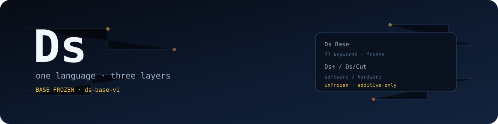
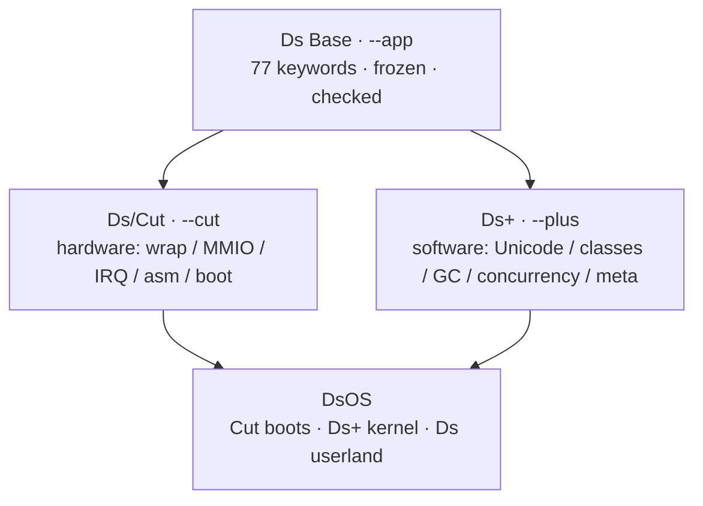

<div align="center">



# Ds

**Static · explicit memory · bare metal · AI-native**

`Ds/Cut ⊂ Ds Base ⊂ Ds+`

[](https://github.com/yzxcrush/ds/actions/workflows/spec-check.yml)
[](https://github.com/yzxcrush/ds/releases/tag/ds-base-v1)
[](https://github.com/yzxcrush/ds-compiler/releases/latest)
[](spec/keywords.json)
[](LICENSE)

[中文](README.md) · [Quick start](#quick-start) · [Architecture](#architecture) · [Docs](#docs) · [Status](#status)

</div>

> **Ds Base is frozen at `ds-base-v1`.**  
> 77 keywords, types/control flow/scopes, checked integers, ASCII identifiers and the AddrSymbol boundary are locked.  
> Additive only from here: **Ds+ grows software, Ds/Cut grows hardware.**

## Quick start

```sh
curl -fsSL https://raw.githubusercontent.com/yzxcrush/ds/main/install.sh | sh
printf 'p("hello, Ds")\n' > hello.ds
dscc hello.ds
```

```ds
fn fib(n) = if n < 2 { n } else { fib(n - 1) + fib(n - 2) }
for i in 0..10 { p(fib(i)) }
```

## Architecture



| Layer | Direction | Status |
|---|---|---|
| **Ds Base** | stable core | 🔒 `ds-base-v1` |
| **Ds+** | software | 🔓 unfrozen, additive only |
| **Ds/Cut** | hardware | 🔓 unfrozen, additive only |

## Docs

| I want to… | Start here |
|---|---|
| Learn the language | [AI card](ai/LANGUAGE_CARD.md) · [Spec](spec/DS-v0.1.md) · [0.1c](spec/DS-CONCISE.md) · [Flow](spec/DS-FLOW.md) |
| Write bare metal | [Ds/Cut](spec/DS-CUT.md) · [Cut compiler](cut/README.md) · [DsOS boot](dsos/) |
| Write software | [Ds+](docs/DS-PLUS.md) · [ds-plus branch](https://github.com/yzxcrush/ds/tree/ds-plus) |
| Manage packages | [dspm](docs/DSPM.md) · [ds-hello](https://github.com/yzxcrush/ds-hello) |
| Read architecture | [DsOS](docs/DSOS.md) · [DSOSS](spec/DSOSS.md) · [Core split](docs/CORE-EXTENSION-SPLIT.md) |
| Audit / freeze | [Audit](docs/AUDIT-v0.1.md) · [Freeze](docs/FREEZE.md) · [Batches](audit/batches.json) |
| Feed an AI | [llms.txt](llms.txt) · [DS_AI_CARD](ai/DS_AI_CARD.txt) · [llms-full](ai/llms-full.txt) |

## Status

| Item | Status |
|---|---|
| Base | 🔒 `ds-base-v1` |
| Ds+ / Ds/Cut | 🔓 unfrozen |
| Python driver | ✅ 216 tests |
| C driver | ✅ differential + 12 strict |
| Cut compiler | ✅ 23 tests |
| Ds+ compiler | ✅ 61 tests |
| Android | ✅ 96 tests, v0.3.8 |
| Releases | [ds-base-v1](https://github.com/yzxcrush/ds/releases/tag/ds-base-v1) · [Android](https://github.com/yzxcrush/ds-compiler/releases/latest) |

```bash
python3 -m unittest discover -s tests
make -C c && sh c/run_tests.sh && sh c/test_strict.sh
PYTHONPATH=cut:. python3 -m unittest discover -s cut/tests
```

## Repository map

```text
spec/       language specs (base / concise / flow / cut / DSOSS / integer)
dsv01/      Python reference implementation
c/          C reference implementation
cut/        Ds/Cut compiler (Thumb / AArch64 asm)
dsos/       boot, context switch, linker scripts
ds-plus/    Ds+ compiler
dsoss/      DSOSS standard and conformance checker
dspm        GitHub-backed package manager
audit/      batch verification / freeze state
docs/       architecture, audit, package docs, landing page
examples/   language examples
```

## Contributing

- Run base conformance before every PR.
- Base accepts bug fixes only; new features go to Ds+ / Cut.
- Never remove existing base keywords or semantics.
- Open an issue and state the target layer (Base / Ds+ / Cut).

---

<div align="center">
<sub>Ds Base v1 — a quiet foundation. Built for DsOS.</sub>
</div>
