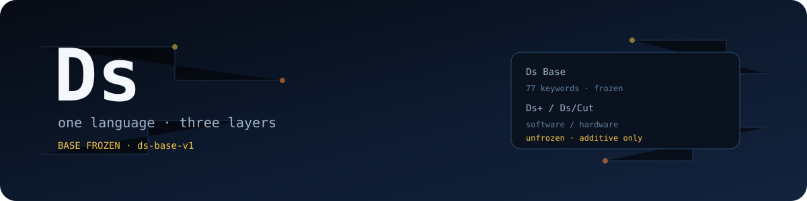
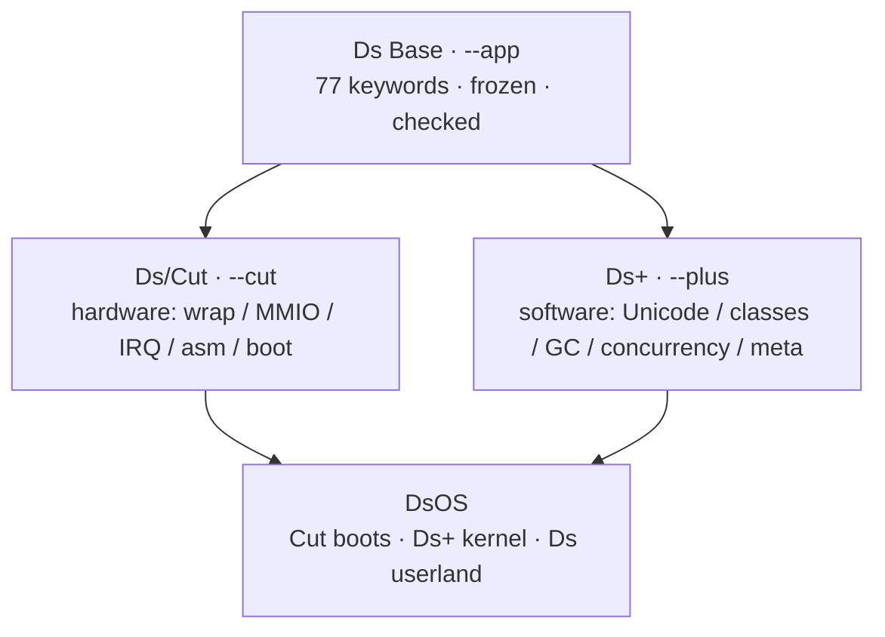

<div align="center">



# Ds

**静态类型 · 显式内存 · 可裸机 · AI 原生**

一套语言，三层边界：`Ds/Cut ⊂ Ds Base ⊂ Ds+`

[](https://github.com/yzxcrush/ds/actions/workflows/spec-check.yml)
[](https://github.com/yzxcrush/ds/releases/tag/ds-base-v1)
[](https://github.com/yzxcrush/ds-compiler/releases/latest)
[](spec/keywords.json)
[](LICENSE)

[English](README.en.md) · [快速开始](#30-秒上手) · [三层架构](#三层架构) · [文档地图](#文档地图) · [工程状态](#工程状态) · [AI 学习包](#ai-学习包)

</div>

> **Ds Base 已冻结为 `ds-base-v1`。**  
> 77 个关键字、类型/控制流/作用域、checked 整数、ASCII 标识符、AddrSymbol 边界都已锁定。  
> 以后只加不减：**Ds+ 向软件，Ds/Cut 向硬件**。

## 30 秒上手

```sh
curl -fsSL https://raw.githubusercontent.com/yzxcrush/ds/main/install.sh | sh
printf 'p("hello, Ds")\n' > hello.ds
dscc hello.ds
```

安装脚本会下载仓库到 `~/.ds/ds`，生成 `dscc` 命令（Termux 写入 `$PREFIX/bin`），并可选构建 C 驱动 `ds-c`。

```ds
fn fib(n) = if n < 2 { n } else { fib(n - 1) + fib(n - 2) }
for i in 0..10 { p(fib(i)) }
```

## 三层架构



| 层 | 方向 | 状态 | 入口 |
|---|---|---|---|
| **Ds Base** | 稳定核心 | 🔒 `ds-base-v1` | `--app` |
| **Ds+** | 软件 | 🔓 不冻结、只加不减 | `--plus` |
| **Ds/Cut** | 硬件 | 🔓 不冻结、只加不减 | `--cut` |

## 为什么是 Ds

- **一套语义，三种交付**：应用、系统、裸机共用同一个语义核心。
- **Token 效率**：经典 → 0.1c 精简 → Flow，实测减少约 **49%** token。
- **可预测**：显式内存、确定性析构、错误分层、结构化并发、布局可控。
- **AI 原生**：`llms.txt`、语言卡、SFT/评测集、三套可对拍实现。
- **不是换皮**：Flow 的 `\` 定义 + 并置调用 + `.` 结束块不属于主流语言语法家族。

完整论述：[docs/WHY-DS.md](docs/WHY-DS.md)

## 文档地图

| 你想…… | 从这里开始 |
|---|---|
| 学语言 | [AI 语言卡](ai/LANGUAGE_CARD.md) · [完整规范](spec/DS-v0.1.md) · [0.1c](spec/DS-CONCISE.md) · [Flow](spec/DS-FLOW.md) |
| 写裸机 | [Ds/Cut 规范](spec/DS-CUT.md) · [Cut 编译器](cut/README.md) · [启动/链接脚本](dsos/) · [Step 1 机器码](dsos/toolchain/step1/README.md) · [Step 2 dscc 后端](dsos/toolchain/step2/README.md) · [Step 3 最小 DsOS](dsos/toolchain/step3/README.md) · [Step 4 函数/栈帧](dsos/toolchain/step4/README.md) · [Step 5 算术/分支](dsos/toolchain/step5/README.md) · [裸机镜像](dsos/images/x86_64/README.md) · [Phase 1 内核](dsos/phase1/README.md) |
| 写软件 | [Ds+ 一页纸](docs/DS-PLUS.md) · [Ds+ 分支](https://github.com/yzxcrush/ds/tree/ds-plus) |
| 用包管理 | [dspm 规范](docs/DSPM.md) · [ds-hello 示例包](https://github.com/yzxcrush/ds-hello) |
| 看架构 | [DsOS](docs/DSOS.md) · [DSOSS 标准](spec/DSOSS.md) · [核心/扩展分层](docs/CORE-EXTENSION-SPLIT.md) |
| 看审计 | [审计报告](docs/AUDIT-v0.1.md) · [冻结策略](docs/FREEZE.md) · [批次状态](audit/batches.json) |
| 喂给 AI | [llms.txt](llms.txt) · [AI 卡](ai/DS_AI_CARD.txt) · [llms-full](ai/llms-full.txt) |

## 工程状态

| 项目 | 状态 |
|---|---|
| Base | 🔒 `ds-base-v1`，只修 bug |
| Ds+ / Ds/Cut | 🔓 不冻结，只加不减 |
| Python 参考驱动 | ✅ 216 项 |
| C 参考驱动 | ✅ 对拍 + 12 项严格性 |
| Cut 编译器 | ✅ 23 项 |
| Ds+ 编译器 | ✅ 61 项 |
| Android 编译器 | ✅ 96 项，v0.3.8 |
| 发布 | [ds-base-v1](https://github.com/yzxcrush/ds/releases/tag/ds-base-v1) · [Android](https://github.com/yzxcrush/ds-compiler/releases/latest) |

验证：

```bash
python3 -m unittest discover -s tests
make -C c && sh c/run_tests.sh && sh c/test_strict.sh
PYTHONPATH=cut:. python3 -m unittest discover -s cut/tests
node ../ds-android/tests/node_test.js   # 若本地有 Android 仓库
```

## AI 学习包

- 一页纸：[ai/LANGUAGE_CARD.md](ai/LANGUAGE_CARD.md)
- 可直接复制：[ai/DS_AI_CARD.txt](ai/DS_AI_CARD.txt)
- 全量上下文：[ai/llms-full.txt](ai/llms-full.txt) · [llms.txt](llms.txt)
- 数据集：`datasets/ds_sft.jsonl`、`datasets/ds_corpus.jsonl`、`datasets/ds_bench.jsonl`

## 仓库导航

```text
spec/       语言规范（base / concise / flow / cut / DSOSS / 整数语义）
dsv01/      Python 参考实现
c/          C 参考实现
cut/        Ds/Cut 编译器（Thumb / AArch64 纯 asm）
dsos/       DsOS 启动、上下文切换、链接脚本
ds-plus/    Ds+ 编译器（software branch）
dsoss/      DSOSS 标准与一致性检查
dspm        GitHub 包管理器
audit/      批次验证 / 冻结状态
docs/       架构、审计、包管理、落地页
examples/   语言示例
```

## 参与

- 提交前跑 base conformance。
- Base 只接受 bug fix；新能力进 Ds+ / Cut。
- 不允许删除 base 已有关键字或语义。
- 讨论请开 issue，说明目标层（Base / Ds+ / Cut）。

---

<div align="center">
<sub>Ds Base v1 — 一块安静的地基。Built for DsOS.</sub>
</div>
